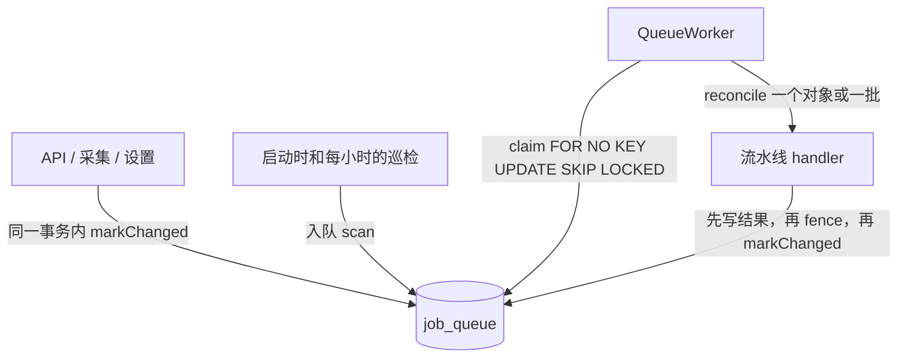

# 后台任务队列

下载、头像、封面、AI 描述、搜索文档和向量，都跑在 PostgreSQL 里的一个 reconcile 队列（`job_queue`）上，由 API 进程内的 `QueueWorker` 执行。本文是这套机制的设计说明，按"现在是什么样"来写；做了哪些取舍、哪些暂时不做，写在第 10 节和第 11 节。上线步骤见 [job_queue_rollout.zh-Hans.md](./job_queue_rollout.zh-Hans.md)。

怎么读：

- 只想了解大概：读第 1、2 节。
- 要改某条流水线或新增一条：读第 3 节的代码地图、第 5 节和第 9 节，再看相应流水线的源码。
- 要动认领、重试、关停这些核心逻辑：第 4、6、7 节都要读，改完跑第 9 节列出的测试。
- 判断一个问题是不是已知的：先看第 10、11、12 节。

## 1. 为什么是这样

后台工作分两类：

| 类型 | 例子 | 机制 |
|---|---|---|
| 衍生数据：由源数据和配置算出来，应当一直保持最新 | 下载、头像、封面、AI 描述、搜索文档、文本和图片向量 | reconcile 队列（本文） |
| 操作：由用户发起，有开始和结束，要能列出、看进度、取消 | 导出 ZIP、存储迁移、外部 Batch API | operation 层，还没有建（11 节） |

衍生数据不按"命令"排队，而是按 Kubernetes controller 的思路做 reconcile：

1. **期望状态靠计算，不另外存。** 期望的结果由源数据和库配置算出。结果行只记录它是用什么生成的（provenance），以及最近一次失败和失败时的输入。输入一变，旧的失败自然就作废了。
2. **队列里只存 key。** 一行 `(流水线, 对象)` 的意思是"这个对象可能过期了，去看一眼"。reconcile 读当前状态，只做有差异的部分，可以重复执行。差异是双向的：缺的补上，不该有的删掉（比如媒体移到别的库之后，挂在旧库下的结果行）。
3. **写入方只报告"什么变了"。** 写入方调用 `markChanged`，由声明表决定哪些流水线跟着更新；入队和业务写入在同一个事务里。处理函数不会直接给下一步入队。
4. **进度、失败、取消都从状态推出来。** 进度就是覆盖率，失败看结果行，取消就是把配置改回去，或者暂停整个库。

### 1.1 参考的系统怎么做

下面是 2026-10 设计时调研过的系统，按它们给本设计提供了什么来分组。各家的做法以当时查到的文档和源码为准，之后没有再核对。

**同类产品：Immich（自托管相册，也有 AI 搜索）**

| | Immich | 我们 |
|---|---|---|
| 执行 | BullMQ（Redis），每种工作一个队列：缩略图、CLIP 语义搜索、人脸、OCR、转码 | Postgres 里一张 `job_queue`，每条流水线（向量按空间）一个队列名 |
| 下一步怎么触发 | `JobService.onDone` 里一个集中的 switch：缩略图完成后入队语义搜索、人脸、OCR。入队不在业务事务里 | 上游只报告"哪个方面变了"，由声明表决定谁跟着更新；入队和业务写入在同一个事务里 |
| 状态 | 每个资源一行 `asset_job_status`，记各类处理的完成时间；"补齐缺失"就是查完成时间为空的行，"全部重做"加 `force` | 结果行自己记 provenance 和失败时的输入，期望状态现算，不另存一份完成时间 |
| 界面 | 按队列显示进行中、等待、失败的计数，提供"缺失 / 全部"两个按钮，没有"每次操作一条任务记录" | 按"库 × 流水线"显示，进度就是覆盖率；同样没有任务历史 |

Immich 的界面和"补缺失"思路我们照搬了。没有学它在完成回调里串下一步：我们的入口很多（改标签、改信息、替换文件、移动库、回收站恢复都会让下游过期，而它们都不是"上一步完成"），一个产出又有多个下游（封面一变，描述和每个空间的图片向量都要更新），在回调里串的话，每加一条流水线都要回头改所有上游。

**reconcile 和依赖声明：Kubernetes、Dagster、Dropbox Cape**

| 我们的做法 | 来源 |
|---|---|
| 队列只存 key，worker 读当前状态、只做差异 | Kubernetes controller 的 level-triggered reconcile；Dagster 判断资产是否最新 |
| `(流水线, 对象)` 主键去重，运行中再入队就标 `dirty`，跑完再跑一次 | client-go workqueue 的 dirty / processing 集合，语义一致 |
| 按对象指数退避，加随机抖动 | client-go 的 `ItemExponentialFailureRateLimiter` |
| 失败记在结果行上，带当时的输入 | Kubernetes 的 `status.conditions` 加 `observedGeneration` |
| 下游声明自己读什么，上游不知道谁在用它 | Kubernetes controller 的 `Watches(...)`；Dagster 资产的 `deps` 加 `AutomationCondition.eager()`；Dropbox Cape 每个 lambda 在配置里声明订阅的 domain |
| 写入方只报告"某对象的某方面变了" | Cape 的写入方只发一个轻量的 ping，不点名谁去处理 |
| 定期巡检补漏 | Kubernetes 的 resync；Dagster 的 `on_missing`；Cape 的 Refresh worker 持续扫库 |
| 改配置后边扫描边入队 | Dagster backfill；Kubernetes 的 list 加 resync |
| 进度现算 | Kubernetes Deployment 的 status 也是算出来的 |
| 取消就是把期望改回去，另加库级暂停 | Kubernetes 改 spec。暂停是我们补的：用户想停掉一次大回填，又不想改回配置 |

**Postgres 队列的执行细节：River、Oban、graphile-worker、pg-boss、DBOS**

| 我们的做法 | 来源 |
|---|---|
| 租约 + `SKIP LOCKED` 认领 + fencing token | River、Oban、graphile-worker 都是这一套；我们用更轻的 `FOR NO KEY UPDATE` |
| 入队和业务写入在同一个事务里（transactional enqueue） | River 文档把它当作构建可靠系统的默认做法，Oban、graphile-worker 也以此为卖点；Rails 8 的 Solid Queue 也说明业界在从 Redis 队列转回数据库队列 |
| 中止后 30 秒不返回就算卡死，让出槽位 | River 的 stuck job 处理 |
| 索引尽量少、认领事务保持很短 | DBOS 的 "Making Postgres queues scale"：删除频繁的队列表死元组多，会拖慢查询计划 |
| 重试 5 次后记到结果行，等输入变化或用户重试 | River 默认 25 次、约 3 周，Sidekiq 默认 25 次、约 20 天。我们的失败记在结果行上，用户能看到并一键重试，输入一变也会自动重来，所以不需要用几周的重试来等外部恢复 |

**攒批：AWS Lambda**

批内出现输入错误时二分定位，同 Lambda 事件源映射的 `BisectBatchOnFunctionError`。

**为什么没有直接用现成的库**

| 候选 | 能提供的 | 没选的原因 |
|---|---|---|
| pg-boss | Postgres、支持 Bun、带 Drizzle 适配器、可以事务内入队；`singletonKey` 加 `stately` 能做到"一个在跑时再排一个"；`batchSize`、`group` | 执行端没有限流（throttle 只在发送时起作用），`groupConcurrency` 是每组封顶而不是轮转，表达不了每个 provider 各自的并发上限；`stately` 下同一个 key 只能有一个在重试；`flow()` 只能连接同一次调用里建的 job。按 provider 限流和熔断、按库暂停、按空间攒批都还得自己写进认领条件 |
| graphile-worker | Postgres、`job_key` 去重和替换、数组 payload 合并 | 正在执行的 job 不动，另建一个新 job；分组公平、限流文档里没有 |
| BullMQ | Node 的事实标准，Immich 在用，我们也已经部署了 Redis | 入队不能和业务写入在同一个事务里；状态在 Redis，必须开持久化；按组公平调度在付费的 Pro 版 |
| DBOS | Postgres、持久工作流 | 同一个去重 id 在排队或执行中时，再入队直接报错，执行期间的修改会丢；几十万个媒体各建一条持久工作流，每步写检查点，开销偏大；Bun 没有官方支持，社区小 |
| Temporal、Hatchet、Inngest、Restate | 完整的工作流编排 | 要另外部署服务，对自托管的媒体应用太重；我们的衍生数据不需要分支、汇合、补偿 |

另一个考虑是后端以后可能迁到 Go。换语言时，没有哪个引擎能把正在跑的工作带过去：pg-boss、BullMQ 的任务格式绑定在库上；Temporal、DBOS 虽然有 Go SDK，但进行中的工作流要靠同一份代码重放才能恢复。我们的队列里只有 key，Go 那边照着同一张表重写 worker 即可，那时 River 仍是候选（它的去重可以设为只在等待中生效，加 advisory lock 就能得到同样的语义）。

结论是自己写：需要的调度语义（按对象合并、运行中再入队、按 provider 限流和熔断、按库暂停、优先级、按空间攒批）都要写进认领条件，现成的库只能覆盖其中一部分。队列本身也只有几个操作（4.2 节）。

将来的 operation 层参照 durable execution 的写法（Temporal、DBOS、Absurd、Cloudflare Workflows 的 `ctx.step`），见 11 节。

## 2. 一张图



## 3. 代码地图

| 位置 | 内容 |
|---|---|
| `apps/server/src/infra/queue/pipelines.ts` | 声明表：每条流水线读哪些方面（aspect）、产出哪些方面；队列名的格式；加锁顺序；启动时的环检查 |
| `infra/queue/changes.ts` | `markChanged`、`requeue`（"重试失败"用）、`requestScan` |
| `infra/queue/store.ts` | 对 `job_queue` 的全部 SQL：`enqueue`、`claim`、`claimBatch`、`fence`、`finish`、`defer`、`postpone`、`giveUp`、`advance`（scan 翻页）、暂停开关、计数 |
| `infra/queue/worker.ts` | `QueueWorker`：轮询、槽位、心跳、超时和中止、卡死检测、scan 执行、巡检、drain |
| `infra/queue/types.ts` | handler 接口：`reconcile` / `reconcileBatch` 的返回值、`recordFailure`、`scanPage` 等 |
| `infra/queue/policy.ts` | 常量：租约、心跳、重试次数和退避、超时、scan 页大小、巡检间隔、优先级 |
| `infra/queue/status.ts` | 任务页用的状态、失败列表、"重试失败" |
| `infra/queue/handlers.ts` | 流水线名到 handler 的注册表 |
| `features/ingest/download-pipeline.ts` | `download` |
| `features/author/avatar-pipeline.ts` | `avatar` |
| `features/media/cover-pipeline.ts` | `cover` |
| `features/ai/describe-pipeline.ts`、`index-pipeline.ts`、`embed-pipeline.ts` | `ai.describe`、`ai.index`、`ai.text` / `ai.image`（共用一个文件） |
| `features/ai/rate-limit.ts` | Redis 限流器和熔断 |
| `features/ai/embedding-spaces.ts` | 向量空间的提升和删除 |
| `api/jobs.ts` | `GET /api/jobs/pipelines`、暂停开关、失败列表、"重试失败" |
| `apps/web/app/pages/jobs.vue`、`components/jobs/`、`components/GlobalProviderNotice.vue` | 任务页和顶部的 provider 封锁提醒 |
| `docker/entrypoint.ts` | 容器的 1 号进程，负责把关停信号传给 server 并等它退出 |

## 4. 队列

### 4.1 表

```sql
job_queue(
  pipeline text, subject_id text, library_id uuid,
  priority smallint, enqueued_at timestamptz, available_at timestamptz,
  dirty boolean, cursor text,
  lease_token uuid, lease_expires_at timestamptz, attempts int, interruptions int,
  PRIMARY KEY (pipeline, subject_id)
)
-- 另有认领用的 job_queue_claim_idx (priority DESC NULLS LAST, available_at)，以及进度用的 (library_id, pipeline)
```

`pipeline` 列存的是队列名，不只是流水线名：

- 普通流水线就是流水线名，比如 `cover`。
- 按向量空间拆分的流水线带空间行 id，比如 `ai.text:<空间行 id>`，每个空间单独填充、单独计数。
- 库扫描的队列名加 `scan:` 前缀，对象是 library_id，比如 `scan:cover`、`scan:ai.text:<空间行 id>`。

### 4.2 操作

语义和 client-go 的 workqueue 一致：

- **enqueue**：`INSERT … ON CONFLICT DO UPDATE`。行已存在时，`priority` 取两者中较高的；这一行正在运行就标 `dirty`。同一对象改多少次，队列里都只有一行。
- **claim**：选出到期、且没有租约或租约已过期的行，`FOR NO KEY UPDATE SKIP LOCKED` 锁住后写上租约，同时 `attempts + 1`。过期的租约在这里直接回收，不需要单独的 sweeper。认领时跳过暂停的库，并且只认领本版本认识的队列名。
- **finish**：校验 `lease_token` 后删除这一行。被标了 `dirty` 的，释放租约后立刻重跑。
- **defer**：失败后用，按指数退避加抖动设置新的 `available_at`，释放租约。
- **postpone**：被限流时用，和 defer 一样释放租约，但把这次认领计入的 `attempts` 退回。
- **giveUp**：重试次数用完时用，先由流水线的 `recordFailure` 把失败写到结果行，再删除队列行。

worker 每秒轮询一次到期的行，最多同时跑 8 个 run（所有流水线共用）。没有用 `LISTEN/NOTIFY`：新工作最多晚 1 秒开始，换来的是不需要单独的监听连接，经过连接池也不受影响。

### 4.3 租约和 fencing

- 租约 60 秒，运行期间每 20 秒续一次。续约失败时中止这个 run。
- 写结果的事务里，要在写完结果之后、`markChanged` 之前调用 `fence`，确认队列行的 `lease_token` 仍是自己的。租约已经过期的 worker 写不进去，事务回滚。同一 `(流水线, 对象)` 只有一行、一个租约，所以不会有两个 worker 同时描述同一个媒体。
- **加锁顺序全系统一致：先结果行，后队列行。** 所以 fence 放在写完结果之后。`enqueue` 一次写多行时按 `queueLockOrder` 排序（scan 在自己的流水线之前，流水线在读它产出的流水线之前），`PIPELINES` 的声明顺序因此必须是依赖顺序，有测试保证。压测（8 个写入方对 16 个并发 run，15 秒）：fence 放在写入之前有 108 次死锁，放到写入之后 0 次，吞吐约高 10 倍，所以没有加 40P01 重试。
- `giveUp` 也守这个顺序：先写结果行，再删除没有被标 `dirty` 的队列行；一行也没删到时整个事务回滚。被标了 `dirty` 就重跑，租约丢了就什么也不做。

### 4.4 至少一次

崩溃、租约过期、关停都可能让同一次 reconcile 再跑一遍，所以每个 handler 都必须幂等：开头先读当前状态，已经是最新的就直接结束。

## 5. 流水线

### 5.1 声明表

| 流水线 | 对象 | 读的方面 | 产出 | 失败记在哪 |
|---|---|---|---|---|
| `download` | media | `media.source` | `media.content`（内容 track 的文件） | track / media 的 `sync_status`、`last_error` |
| `avatar` | author | `author.avatar_source` | `author.avatar_file_id` | `author.avatar_error`、`avatar_error_origin` |
| `cover` | media | `media.content`、`media.library`、`library.cover_config` | `media.cover`（cover track） | cover track 的 `last_error`、`metadata.error_source_file_id` |
| `ai.describe` | media | `media.content`、`media.cover`、`media.library`、`library.ai_config` | `media.description`（`asset_ai_metadata`） | `asset_ai_metadata.last_error`、`error_input_hash` |
| `ai.index` | media | `media.description`、`media.meta`、`media.library` | `media.search_doc`（`asset_search_document`） | 不调用 provider，只打日志 |
| `ai.text:<空间>` | media | `media.search_doc`、`media.library`、`library.spaces` | `asset_embedding` | `asset_embedding.last_error`、`error_input_hash` |
| `ai.image:<空间>` | media | `media.content`、`media.cover`、`media.library`、`library.spaces` | `asset_embedding` | `asset_embedding.last_error`、`error_input_hash` |

- `ai.describe` 和 `ai.image` 也读 `media.content`：没有生成封面的图片直接用内容图。
- 失败旁边都记着失败时的输入（`error_input_hash`、`error_source_file_id`、`avatar_error_origin` 等）。输入一变，scan 就会重新拉起它。描述的哈希由图片、模型、prompt 版本、语言算出；向量的哈希是搜索文档或图片的哈希。
- `ai.index` 的 scan 比较内容哈希，所以巡检会重试它的失败，也能发现漏报的变化。代价是每 200 个媒体多一组查询。哈希取决于标签名，标签名先排序。
- `media.library` 表示媒体换了库。AI 结果行带自己的 `library_id`，reconcile 发现和媒体当前的库不一致，就删掉再按新库的配置重建。cover track 不分库：新库配置里有的质量，只要源文件没变就直接复用；配置里没有的质量照旧保留，不删。

### 5.2 markChanged

```ts
markChanged(tx, aspect, ids)
```

- 媒体级的方面：直接给读它的流水线入队，优先级为 `Priority.CHANGE`。`ai.text` / `ai.image` 展开成该库正在写入的每个空间各一条。
- 库级的方面（`library.*`）：给读它的每条流水线入队一行 scan，对象是 library_id。
- 只有产出**真的变了**才调用 `markChanged`；reconcile 发现已是最新，就不往下传。例外是封面：它是别的流水线等待的前置条件，所以最终失败时（`recordFailure`）和无事可做时（返回 `{ kind: "done", changed }`，在删队列行的事务里报告）也报告 `media.cover`，否则等它的 `ai.describe`、`ai.image` 再也不会被唤醒。
- 每个 reconcile 开头先检查前置条件，比如封面没好时 `ai.describe` 直接结束，不记失败。封面写好后报告的 `media.cover` 会再把它入队。

### 5.3 scan 和巡检

- scan 每跑一步，从 `cursor` 往后取 200 个对象，只挑需要处理的（和覆盖率统计用同样的条件，跳过失败仍然适用于当前输入的对象），按 `Priority.BACKFILL` 批量入队，再保存 `cursor`，扫完就删除这一行。
- 扫描期间再次触发时 `cursor` 清零，从头重扫。已入队的行运行时读的是当前配置，所以不会生成过期的东西。
- scan 没有结果行可以记录失败，放弃还会丢掉进度，所以不设次数上限：每次失败打日志，退避后接着跑。
- **巡检**：进程启动时和之后每小时，给每个库的每条流水线入队一次 scan，补上漏报的变化。只靠定时的话，重启比间隔频繁的服务永远等不到巡检，所以启动时也跑。各流水线的 upkeep（比如向量空间的提升）也在巡检里执行，一条失败不影响其他的。

### 5.4 向量空间的切换

换文本或图片向量模型时，新空间以 BUILDING 状态建出来，和旧空间同时写入。每次 `ai.text` / `ai.image` 跑完以及巡检时，如果新空间的队列（包括 scan）已经清空，就按覆盖率判断能不能提升为 ACTIVE；提升时删掉被替换空间的队列。删除空间时，`dropSpace` 在用户请求里用一条 `DELETE` 同步删掉全部向量（取舍见 10 节）。

## 6. 失败、重试和中断

### 6.1 三类结果

handler 返回 `done`，或者下面三类之一（抛异常等同于 `retry`）：

| 类别 | 例子 | 处理 |
|---|---|---|
| 输入被拒（`rejected`） | 图片超过大小上限或格式不支持、provider 返回 413、下载返回 400 / 404 / 410、FFmpeg 解不开文件、连续中断 | 不重试，失败连同输入写到结果行。scan 跳过它，直到输入变化或用户点"重试失败" |
| 其他失败（`retry`），未知错误也算这类 | provider 返回 400 / 422、其他 4xx、5xx、超时、网络错误、鉴权失败、存储不可用 | 退避重试（5 秒 × 4ⁿ，加抖动，最长 300 秒），默认最多 5 次，用完后和被拒一样写到结果行 |
| 限流（`deferred`） | provider 打满、熔断中 | `postpone` 到限流器给出的时间，不计次数 |

- 判断不准的错误一律当作可重试，只有确定是输入的问题才拒绝。provider 对配置错误也会返回 400 / 422，CDN 也会临时返回 403，所以这些都按其他失败处理。
- 次数用完的失败也记下输入，巡检不再拉起它。否则持续失败的对象每小时要再试 5 次，一直消耗 provider 配额。代价见 10 节。
- 结果行上还留着失败时，不算"已是最新"：输入改回原来的样子再做一次，就能清掉那条失败。
- "重试失败"清掉失败记录后重新入队（`requeue`），优先级和编辑触发的一样。

### 6.2 中断

一次 run 不成功有两种结束方式，队列分开记：

- **失败**：run 跑完了，handler 返回 `retry` 或 `rejected`，知道错在哪。
- **中断**：run 没跑完，进程崩溃、被杀或卡死，租约过期后由下一次认领回收。错误没能报出来，队列只知道上一次没有结束。

两个计数回答的问题不一样：

| | `attempts` | `interruptions` |
|---|---|---|
| 回答 | 这个对象还值不值得再试 | 运行它会不会把 worker 打挂（毒丸） |
| 增加 | 每次认领加 1，被中断的那次也算 | 认领时发现上一次的租约没有释放，加 1 |
| 清零 | 输入变化、"重试失败"、scan 翻页 | 同左，另外 run 正常失败（`defer`）也清零；`postpone` 不动，因为被限流的 run 根本没开始 |
| 检查 | run 返回 `retry` 时：没到上限就退避重试，到了就放弃，记下这次的错误 | 开跑前：连续中断达到上限（默认 5）就不再运行，记成"输入被拒"，错误是 "The run was interrupted N times in a row" |

中断要在开跑前检查，因为被中断的 run 走不到跑完后的那一步。不设这条，毒丸每小时会被巡检重新拉起，把 worker 再打挂一轮。失败和中断交替出现时不算毒丸，最后由 `attempts` 按普通失败放弃。攒批的流水线也不把有中断记录的行放进批里（7.4 节）。

**为什么不合成一个计数。** `attempts` 已经包含中断，只用它也能抓毒丸：开跑前 `attempts` 超过上限就放弃。这样能省掉一列和几处清零，但会把偶然的崩溃算到对象头上。一个对象先失败 4 次，第 5 次运行时进程恰好被杀，下次认领就会直接放弃，不再跑最后一次；结果行记下的是"被中断"，而不是真正的错误（比如 provider 返回的 502），看起来像是输入的问题。默认只有 5 次，一次崩溃就占掉五分之一。

分开计数的代价是多一列，几个释放租约的操作要各自清零它；崩溃仍然会连累同一进程里同时运行的行（10 节）。

**别的队列怎么做。** 两种做法都常见（2026-11 查的文档）：

- 单独计数：Sidekiq Pro 的 super_fetch 把崩溃后找回的任务另外记，72 小时内找回 3 次算毒丸，和异常重试的次数无关；BullMQ 用 `stalledCounter` 和 `maxStalledCount`（默认 1），和 `attemptsMade` 分开。
- 合成一个：Oban、River、Graphile Worker 在认领时加次数，崩溃自然占一次；SQS 的接收次数、Temporal 的心跳超时也是这样。它们的默认次数大得多（River 25、Oban 20），一次崩溃占的比例小。

## 7. 运行时

### 7.1 超时和卡死

- 每个 run 有总时长上限，默认 10 分钟。`download` 是 2 小时：大文件在慢线路上本来就慢，真正停滞的连接由 30 秒空闲读超时处理。超时后中止 run，按失败重试，不看中止后它报告了什么，因为这时的错误（比如渲染进程被杀）说明不了输入有问题。
- 中止后 30 秒还没返回的 run 算卡死，不管中止原因是超时、丢租约还是关停。JS 杀不掉它，所以 worker 不再等它，让出槽位并停掉心跳。租约过期后这一行按中断处理；它之后的写入被 fence 挡住。卡死的 run 还占着内存和连接，超过 8 个时进程优雅关停并以退出码 1 退出，由 k8s 或 Docker 重新拉起。
- handler 等待的所有东西都要接收 `ctx.signal`。

### 7.2 数据库超时

连接都带 `statement_timeout`（默认 120 秒，`DB_STATEMENT_TIMEOUT_MS` 可调，0 表示不限，给确实要跑得更久的一次性脚本用）、`lock_timeout`（30 秒）、`idle_in_transaction_session_timeout`（60 秒），再加客户端的 `query_timeout`，兜住服务端或网络不响应的情况。这些参数在建连时发送，以后接 PgBouncer 要配 `ignore_startup_parameters`。

### 7.3 关停

- 收到 SIGTERM 后先等 10 秒，让进行中的 run 自然结束；之后中止其余 run，它们的行用 `postpone` 放回，不计次数，最多再等 5 秒。中止错误归为取消，不计入熔断。不响应中止信号的 run 等租约过期，算一次中断。
- `docker/entrypoint.ts` 是容器的 1 号进程，把信号转给子进程，等子进程全部退出后才退出，退出码用 server 的。这样 drain 能跑完，卡死重启的退出码 1 也不会丢。
- drain 最长 15 秒，k8s 默认的 30 秒宽限期够用；`docker-compose.yml` 配了 `stop_grace_period: 30s`（Docker 默认只有 10 秒）。

### 7.4 攒批

`ai.text:<空间>` 和 `ai.image:<空间>` 一次认领同一队列里最多 N 行（由 provider 决定，比如文本 64、Gemini 图片 6），发一次 provider 请求，每行单独结算。

- 不等凑满，有多少取多少。批内只解析一次 `AiService.forLibrary()`。
- 失败过的行继续攒批，否则一次 provider 故障之后，积压的行全变成单条请求。同一批失败的行共用一个退避时间（按批内最大次数算），回来时还是一批。
- 有中断记录的行单独跑，因为运行它本身可能就是 worker 挂掉的原因。
- 批内的输入错误由 `embedSplittingOnInputError` 在这次运行里二分定位：对半拆开重发，直到坏的那一项单独失败，其他项正常拿到向量（同 AWS Lambda 的 `BisectBatchOnFunctionError`）。拆批时遇到的 400 / 422 按其他失败重试，不记成被拒，也不计入熔断。其他错误作用于整批。

## 8. 调度：限流、熔断、优先级、暂停

- **限流**：provider 打满时，Redis 限流器（`rate-limit.ts`）给出可重试的时间，行按这个时间 `postpone`，不计失败。限流在多个进程之间共享。
- **熔断**：也在 Redis 限流器里，和限流共用冷却键，另加一个连续失败计数。指向 provider 的失败（鉴权、不可用、模型、未知）连续 5 次后封锁 30 秒，之后每次探测失败时长翻倍，最长 1 小时；任何一次成功都会清零。封锁期间调用方看到的和限流一样，行走 `deferred`，不计次数，也不请求 provider。输入错误和 429 不计入。provider 的 Key、地址或模板更新时清除封锁。熔断开始时打 `[AI LIMIT]` 日志。
- **优先级**：两档。写入方报告的变化是 `Priority.CHANGE`，scan 找到的是 `Priority.BACKFILL`，所以新内容不会被整库回填饿死。认领用 `ORDER BY priority DESC NULLS LAST, available_at`，正好用上 `job_queue_claim_idx`。
- **暂停**：`library.jobs_paused`，用户在任务页按库开关，存在数据库里，重启后仍然有效，作用于该库所有流水线。
  - 只有认领读这个字段：运行中的 run 继续跑完；入队、scan 和巡检照常，行留在队列里，恢复后按原来的优先级和时间处理。
  - 恢复后 worker 在下一次轮询（1 秒内）认领。暂停和恢复只写 `library`，不碰队列行，所以不会打乱加锁顺序。
  - 删除库时清掉暂停，否则排队的行没人能放行。
  - 成本：20 万行到期积压（pg18），没有暂停的库时选行 0.04 毫秒，暂停库的 20 万行排在前面时 17.6 毫秒；库增加到 2 万个时分别是 0.8 和 18.4 毫秒，所以 `library` 上没加索引。

## 9. 进度、界面和测试

### 9.1 进度

进度直接从状态算，没有任务计数器：

| 显示项 | 算法 |
|---|---|
| 总数 | 库里有效媒体的数量 |
| 剩余 | `job_queue` 里该库、该流水线的行数 |
| 已处理 | 总数 − 剩余（scan 只入队需要处理的对象，所以成立） |
| 正在处理 / 重试中 | 剩余行里租约有效的 / `attempts > 0` 且没有有效租约的 |

- 该库的 scan 行还在时显示"正在统计…"，否则剩余数会偏小。
- `enqueued_at` 只在建行时写，重试、`postpone`、再次入队都不改，所以能看出真实的等待时长。`GET /api/jobs/pipelines` 返回最久等待时长（包括 scan 行）和 provider 剩余封锁时长（`blocked_seconds`，包含 429 冷却）。
- 不保留任务历史，要追查时看日志。

### 9.2 界面

- 任务页（`jobs.vue`）按"库 × 流水线"显示排队、处理中、失败及原因，每 5 秒轮询；有"重试失败"和暂停开关。设置页的封面和 AI 进度每 2 秒轮询，暂停时显示"已暂停"。
- 顶部提醒（`GlobalProviderNotice.vue`）：当前库的 provider 封锁至少 2 分钟时出现，连续失败的 provider 第三次封锁就到这个时长。每 60 秒读一次 `blocked_seconds`，标签页隐藏时和在任务页上不轮询。用户关掉后，这次封锁结束前不再出现。

### 9.3 接口

- `GET /api/jobs/pipelines?library_id=`：各流水线的状态、是否暂停、等待和封锁时长。
- `PUT /api/jobs/pipelines/:library_id/paused`，body `{ paused }`。
- `GET /api/jobs/pipelines/:library_id/:pipeline/failures`、`POST /api/jobs/pipelines/:library_id/:pipeline/retry-failed`。
- `POST /api/ai/media/process`：重试已记录的失败，并给四条 AI 流水线各请求一次 scan。
- 以上接口都校验库归属和 API 令牌的库范围。

### 9.4 新增一条流水线

1. 在 `pipelines.ts` 的 `PIPELINES` 里声明对象、读的方面和产出，按依赖顺序放（读它产出的流水线排在它后面）。需要新方面时加到 `Aspect`。
2. 实现 handler（`types.ts`）：
   - `reconcile`：读当前状态，只做差异；写结果的事务里先写，再 `ctx.fence(tx)`，再 `markChanged` 产出的方面（只在真的变了时）。
   - `recordFailure`：把失败连同输入写到结果行。结果行上没有地方记失败的话，先加字段。
   - `scanPage`：按对象 id 翻页，只返回需要处理、且失败不适用于当前输入的对象。
   - `countFailures`、`listFailures`：任务页用。
   - 可选：`maxAttempts`、`timeoutMs`、`blockedMs`、`patrol`、`settled`。
3. 在 `handlers.ts` 注册。
4. 让所有改动输入的写入方，在自己的事务里调用 `markChanged`。
5. 加测试，跑第 9.5 节的命令。新流水线可以滚动发布，旧版本只认领自己认识的队列名。删掉一条流水线时，它留下的行要在上线步骤里手动删。

### 9.5 测试

- `bun test`：单元测试，包括 `queue_pipelines.test.ts`（声明表、加锁顺序）和 `queue_failures.test.ts`。
- `bun run test:queue:db`、`bun run test:ai:db`：在真实 Postgres 上测认领、fence、中断、暂停和向量流水线，需要带 `vector`、`pg_trgm`、`unaccent` 扩展的测试库。

## 10. 已知取舍

下面这些是有意接受的代价，或者在单副本、用户很少的部署下还没碰到的问题。真的需要时再改，改之前先确认问题确实出现了。

**失败和重试**

- **长时间故障后不会自动恢复。** 重试次数用完的失败会记下输入，巡检不再拉起，要用户点"重试失败"。熔断期间行会被推迟、不消耗次数，所以受影响的主要是熔断触发前的少数对象，以及配置错误或鉴权失败时的对象。
- **毒丸可能连累同时运行的对象。** worker 崩溃时，同一进程里所有运行中的行都记一次中断，连续 5 次后会被一起记成"输入被拒"，用户点"重试失败"即可恢复。曾经让有中断记录的行单独运行来避免这一点，认领逻辑因此复杂不少，而连续崩溃本身很少见，2026-11-04 回退了；只有攒批时还把它们单独拿出来。
- **`ai.index` 和 scan 的失败只有日志。** 两者都没有结果行可以记失败。`ai.index` 不调用 provider，它失败就是 bug，巡检会再试；scan 失败通常是数据库出了问题，整个应用都会报错。为它们单独记失败，不值得多出来的字段和接口。

**调度**

- **所有流水线共用 8 个槽位。** 一批慢任务（FFmpeg、AI）能占满全部槽位。
- **没有按库轮转。** 一个大库能占满全部槽位，多用户部署时再加。
- **"重试失败"和新内容同优先级。** 它走 `requeue`，优先级和编辑触发的变化一样。
- **限流时不单独暂停队列。** provider 打满时，积压的每一行（攒批的是每一批）在每个等待窗口里会被认领一次、查一次 Redis 后放回，不调用 provider，也不计次数。以前在 worker 内存里按"队列 × 库"记一个到期时间来省掉这些认领，2026-11-04 删掉了：只省空转，不值得多一份状态。
- **新工作最多晚 1 秒开始。** 用轮询代替 `LISTEN/NOTIFY`，2026-11-04 改的，换来不需要监听连接、不受连接池模式限制。
- **暂停只能整库停。** 不能只停某一条流水线，所以暂停期间新上传的媒体也不会生成封面。

**运行时**

- **卡死重启会带上 API。** worker 和 API 在同一个进程，卡死的 run 超过 8 个时整个进程重启。要避免就得拆出独立的 worker 进程。
- **scan 的一步停不下来。** `scanPage` 不接收中止信号。超时或关停时，worker 等 30 秒后让出槽位，那条查询还会占着连接跑完，最长到 120 秒的语句超时；之后的入队被 fence 挡住，这一行记一次中断，下次从 `cursor` 接着跑。`node-postgres` 的查询不接受 `AbortSignal`，传进去也只能在语句之间停下，所以不做。
- **删除向量空间是一条同步的长语句。** 换模型、关掉向量角色、删除 provider 时，`dropSpace` 在用户请求里用一条 `DELETE` 删掉整个空间的向量（删 provider 时是所有库用这个模型的空间），失败时整体回滚，不会删一半。2026-11-05 在本机 pg18 上测过（1536 维 halfvec，带 HNSW）：5 万条 0.66 秒，25 万条 3.8 秒，约 15 微秒一行；DELETE 不碰 HNSW，索引清理留给后台 VACUUM（30 万条 22 秒）。按这个速度，单个空间约 800 万条才会碰到 120 秒的语句超时。真到那个量级时，改成只删空间行和队列行，孤儿向量由巡检分批删除。
- **`AiService.forLibrary` 没有缓存。** 每批都重新解析配置、解密 Key，任务页和顶部提醒也会调用它。
- **autovacuum 用默认参数。** 这张表插入和删除都很频繁，但没有实测出认领变慢之前不单独调。

**可见性**

- **没有通知系统。** provider 熔断只有用户打开应用时能看到的顶部提醒，没有邮件或推送。
- **提醒范围有限。** 暂停没有全局提醒；熔断提醒只看当前库，其他库的封锁要切过去才看得到；设置页有自己的布局，不显示这条提醒；故障开始几分钟后才出现。
- **没有指标和告警。** 只能在任务页看到最久等待和封锁时长。
- **不保留任务历史。** 只看得到当前的队列和当前仍然适用的失败。

## 11. 还没做的

- **operation 层。** 第一个"操作"（导出 ZIP、存储迁移等）要做时再建：
  - 一张 `operation` 表（owner、库、类型、状态、上下文、进度、取消标志、结果、错误），队列里放一行 `op` / operation_id 驱动它。
  - 步骤写成 `await ctx.step(name, fn)`，每步结果存进 operation 行，重试时已完成的步骤直接返回存好的结果，不手写状态机。
  - 长步骤靠心跳续租，取消标志通过心跳传到 AbortSignal，在步骤之间停下；等待（比如导出文件 24 小时后删除）用 `available_at`。
  - 动手前先评估 [Absurd](https://github.com/earendil-works/absurd)（只依赖 Postgres，2026-10 时为 v0.5.1，Go SDK 仍是实验性），不成熟就自己写 `ctx.step`。
  - 不做操作内部的扇出再汇合、分支、补偿，真需要时再评估 Temporal。
- **Batch API。** 2026-10-14 删掉了旧实现（只覆盖文本向量回填，有一套独立的作业状态机）。以后要建在 operation 层上，分提交、轮询、写回三步：
  - 场景优先级：图片描述（单次最贵）优先，向量回填其次。实时路径一直保留，batch 只用于用户明确选择、能接受延迟的整库回填，开关放在"发起回填"这个动作上，不放在供应商连接上。
  - 提交时带可追溯的 `metadata`（比如 OpenAI Batch 的 `metadata`），恢复时先查有没有孤儿作业，避免重复计费。
  - 在途的媒体，各自的 reconcile 跳过；没拿到结果的媒体仍然过期，reconcile 会用实时路径补上，所以部分结果和降级不需要特殊处理。
  - 取消操作时同时取消 provider 端的作业。
  - 协议差异放在 provider 适配器（`submit / poll / cancel`）：OpenAI 和百炼兼容模式用 Files + Batches，Gemini 的 Batch Mode 是另一种格式。
- **复制 post 或媒体到别的库。** 在目标库新建 post、media、track 行，再对新媒体 `markChanged("media.source")`。删除如果是按引用的（删一条记录不会删掉别人还在用的文件），新行直接引用同一批文件，复制就是一次同步请求；否则要真的拷贝文件，量大时做成 operation。
- **按库轮转、按 provider 或流水线划分槽位、通知系统、指标和告警**：见 10 节，有需要时再做。
- **推送进度。** 前端目前轮询；需要时从 `finish` 发 `NOTIFY` 转 SSE。

## 12. 待验证

- 真实 AI provider 和完整的故障演练。熔断提醒是直接写 Redis 模拟封锁验证的。
- 任务页的等待时长和封锁时长显示。暂停开关和顶部提醒已在浏览器看过。
- 提醒被关闭后，封锁结束再次触发时能重新出现。
- 繁体中文的新文案，还没在页面上看过。
- 控制台里 `LibrarySwitcher` 和任务页的 hydration 警告，没有和改动前对比过。
- `cover-all-formats` 测试，需要 S3。
- 生产环境的 Postgres 版本。
- 开发库的 worker 恢复情况。57 行 `ai.text` 的 `attempts` 最高到 112，现在被认领后会再跑一次，再失败就只记错误、由巡检重新入队。还没在开发库上看过。

## 13. 历史

- 2026-10 之前：`async_task` / `async_task_unit` 任务引擎（JobRunner、JobSweeper）加一套独立的 embedding 队列。主要问题：两套重试和关停语义；新内容和编辑不会自动建索引；同一媒体被并发描述；任务之间的依赖靠扫描任务表；限流和调度互不知道，没有熔断；AI 状态存了两份；已被后来的成功解决的失败一直显示。
- 2026-10-25 确定 reconcile 队列方案，分三层实施，都在 `refactor/job-queue` 分支：
  1. 队列、声明表、scan、巡检，迁移 `download`、`avatar`、`cover`（2026-10-27）。
  2. 迁移四条 AI 流水线，含攒批和限流；删除旧引擎、两张任务表和 embedding 队列（2026-10-30）。
  3. 熔断提醒、优先级、库级暂停（2026-10-30）。
- 2026-11-04 加固并简化：中断单独计数、drain 和容器入口、超时；删掉被中断行的单独运行、限流时的内存暂停表和 `LISTEN/NOTIFY`。
- 旧的问题清单和逐层记录在 git 历史的 `docs/async_task_improvements.zh-Hans.md` 里。
