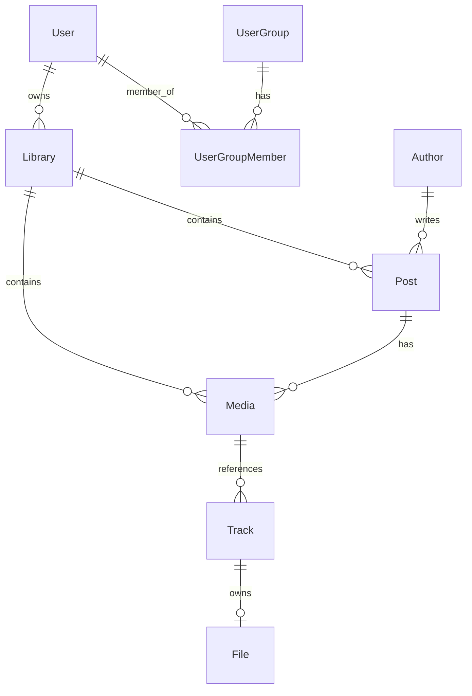
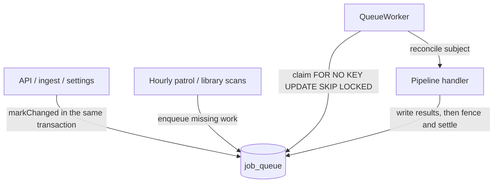

# System Design & Database Specifications

> [简体中文](./system_design.zh-Hans.md)

This document details the business domain relationships, database design guidelines, dual-view UI rendering mechanisms, and multitenant permission layouts used in Stationary.

---

## 1. Database Design Guidelines

To guarantee high-throughput, low-latency, and horizontal scalability during concurrent sync pipelines, all tables follow these architectural database rules:

### 1.1 snake_case Naming
- All table names and column names must strictly follow **`snake_case`**. For example: `avatar_file_id`, `create_time`, and `sort_order`.
- *Note*: Tables created natively by Better Auth (e.g., `better_user`, `better_session`) follow Better Auth's default formatting, but all custom business fields and new tables must use `snake_case`.

### 1.2 Foreign-Key-Free Design (No Physical FKs)
- **Rule**: Do not declare physical foreign key constraints (`.references()`) in Drizzle schema definitions.
- **Why**: Physical foreign keys can trigger lock contention and cascade blocks under high-concurrency writes and make database partitioning or horizontal scaling difficult.
- **Implementation**: Relationships are treated as **logical associations** handled entirely in the application layer. These relations are declared via Drizzle's `defineRelations` in `relations.ts` to allow type safety and relational `with` queries at the API layer.

---

## 2. Core Model Relationships

The schema is divided into three layers: **Content layer**, **Physical asset layer**, and **Multitenant layout**.

### 2.1 Content Layer
- **Author**: Platform-wide unique profile (using the compound index of `library_id` + `platform` + `eid`). Stores nickname, signature, platform, and a reference to their avatar file (`avatar_file_id`).
- **Post**: Belongs to a specific `Library`. Functions as the container for posts synced from social sites, keeping records of platform `eid`, titles, description, tags, and original publishing date (`published_time`).
- **Media**: Belongs to a specific `Post` or floats as an independent asset (`post_id` is null). Stores stable external identity `eid`, title, description, ordering (`sort_order`), type (IMAGE, VIDEO, LIVE_PHOTO, AUDIO, PDF), and publication time. Media no longer stores physical file URLs; physical resources are resolved through `Track` and `File`.

### 2.2 Asset & Storage Layer (`Track` & `File`)
- **File**: Points to physical file locations on S3. Uses a UUID as primary key, tracking an optional audit hash, `size`, `path` (the globally unique S3 object key), and `bucket`. The current business model does not reuse one File across multiple entities; each Track, author avatar, library cover, and draft upload gets its own File. Dimensions, duration, and playback format are Track fields, not File fields.
- **Track**: Connects a `Media` item to its physical `File` records, assigning file roles and formats within that media item. A single logical `Media` item can contain multiple `Track` variants:
  - `type` (TrackType Enum): `IMAGE`, `VIDEO`, `AUDIO`, `SUBTITLE`.
  - `purpose` (TrackPurpose Enum):
    - `CONTENT`: Main asset (the image, video, audio track).
    - `COVER`: The cover frame of a video or static display.
    - `THUMBNAIL`: Extracted small preview image.
    - `PREVIEW`: Low-resolution video or web preview.
  - `quality` (TrackQuality Enum): `HIGH`, `MEDIUM`, `LOW`; original status is expressed by `is_original`.
  - `priority` & `source_url`: Used to download, match, and choose priority streams during synchronization.
- **File & deletion rule**: File records are owned by their current business record. When that record is soft-deleted or replaced, the File is marked `DELETED` in the same transaction. Physical S3 deletion is performed later by the purge worker.

---

## 3. Lifecycle & Deletion Policies

When database foreign keys are disabled, the application layer must enforce referential integrity and handle deletes explicitly.

### 3.1 Recycle Bin Semantics (Soft vs. Hard Delete)
To prevent accidental data loss and guarantee file consistency, the deletion flow is split into two phases:
- **Move to Recycle Bin (Soft Delete)**: The initial delete of a `Post` or `Media` marks the record as deleted by setting `delete_status = DeleteStatus.DELETED` and setting `delete_time`. Associated `Track` and owned `File` rows are updated to `DELETED` in the same transaction; physical S3 objects are handled later by the purge worker.
- **Purge Recycle Bin (Hard Delete / Purge via Cron)**:
  1. The server runs the purge in-process (`startFilePurgeSchedule`) on startup and every 24 hours, in every deployment, to fetch `File` records that have been in the `DELETED` status for more than 30 days. With more than one replica each runs it; a repeat delete is harmless. `POST /api/task/purge-expired-files` with `Authorization: Bearer <CRON_SECRET>` triggers the same purge manually.
  2. For each expired `File`, the background worker deletes the S3 object and then removes the corresponding database row. A file that fails is logged and retried on the next run. The File is not reused by another business record.
  3. This soft-deletion state machine guarantees S3 and DB consistency for the owning business record.

### 3.2 Library Deletion Policy
To prevent accidental deletion, non-empty libraries (`Library`) do not support direct deletes.
- **Pre-deletion Check**: Before deleting a `Library` record, the system verifies that there are no `Post` or `Media` items belonging to it, including recycled ones.
- **Validation**: The deletion is rejected if any content remains under the library. The library can only be deleted when completely empty.

---

## 4. Dual-View UI Mechanism

The user interface supports two primary data viewing flows:

### 4.1 Board View (Post List)
- Focuses on the `Post` unit. Every card renders a Post item, using the media item with `sort_order = 0` as the card's thumbnail cover.
- Displays author info, post titles, tags, and local publishing times.

### 4.2 All Pins View (Media List)
- Focuses on the individual `Media` file. Users can browse images and videos directly. Two display modes are supported:

| Display Mode | SQL Filter Logic | Rendering Output |
| :--- | :--- | :--- |
| **Flat Mode** | No special filter (lists all `Media` items) | Renders every image and video as an independent card. Ideal for granular asset search. |
| **Stacked Mode** | `or(isNull(Media.post_id), eq(Media.sort_order, 0))` | Folds media assets belonging to the same post. Shows only independent files and the **first media (`sort_order = 0`)** of posts, displaying an overlay badge (e.g., `+5`) indicating other assets are grouped under it. |

---

## 5. Multitenancy & Sharing (User Group & Library)

The system supports group collaboration using fine-grained permissions. Ownership (who holds and pays for resources such as AI providers) is separate from access; see [ownership_and_teams.md](ownership_and_teams.md), including the planned team model.

### 5.1 Resource Entity
- **Library**: The physical isolation boundary for assets. All posts and media files must specify their parent `library_id` on creation.

### 5.2 Group Sharing & Access Control
- Users can create their own `Library` instances and build `UserGroup` teams.
- Library shares can be configured via two tables:
  1. **User-level sharing (`LibraryUserAccess`)**: Grants specific view or edit access to a single `User`.
  2. **Group-level sharing (`LibraryGroupAccess`)**: Grants access to all members of a `UserGroup`.
- **Access Roles**:
  - `VIEWER`: Read-only access to browse and retrieve assets.
  - `EDITOR`: Read and write access to upload, move, or edit posts and media.
  - `ADMIN`: Full administrative control, including library deletion and permission management.

---

## 6. Background Job Queue

Background work (downloads, covers, avatars, AI descriptions, search documents and vectors) runs on a reconcile queue kept in PostgreSQL (`job_queue`) and an in-process `QueueWorker`. There is no message broker; Redis is only used to share AI provider rate limits. Code lives in `apps/server/src/infra/queue`; the full design, its tradeoffs and what is not built yet are in [job_queue.zh-Hans.md](./job_queue.zh-Hans.md) (Chinese).

### 6.1 Data Model

- **One row per (queue, subject)**: a queue is a pipeline (`download`, `avatar`, `cover`, `ai.describe`, `ai.index`, `ai.text`, `ai.image`), optionally per embedding space, plus a `scan:` queue per library. Enqueuing an existing row merges into it; a row that is running is marked `dirty` and reruns once the current run settles.
- **Pipelines reconcile, they do not replay commands**: each handler reads the subject's current state and brings its outputs up to date. Writers only report which aspect of a subject changed (`markChanged`), and `infra/queue/pipelines.ts` maps aspects to the pipelines that read them.
- **Results live on the result rows**: failures and the input they happened on are stored next to the outputs (for example `track.last_error`, `asset_embedding.last_error` and `error_input_hash`). A queue row is deleted when its run finishes.

### 6.2 Execution and Safety

1. **Claiming**: due rows are leased with `FOR NO KEY UPDATE SKIP LOCKED`, highest priority first (changes before backfills), skipping libraries the user paused. The worker polls every second; expired leases are reclaimed by the same claim, so there is no sweeper.
2. **Leases and fencing**: a 60-second lease is renewed every 20 seconds. Results are written first and the queue row is fenced afterwards, so a worker that lost its lease cannot commit. All writers lock result rows before queue rows.
3. **Retries**: failed runs back off exponentially with jitter (5 s × 4ⁿ, at most 300 s) for 5 attempts by default, then the failure is recorded on the result rows. Rate-limited runs are postponed without using an attempt. Inputs a provider rejects are not retried until they change.
4. **At-least-once**: a run can be repeated after a crash, so handlers must be idempotent.
5. **Patrol and scans**: on start and every hour each library gets a scan per pipeline, which pages through its media and queues what is missing or stale.

### 6.3 Cover Generation & Reconciliation Specification

Cover generation, updating, and reconciliation workflows are governed by the `cover` pipeline and `CoverService` following these specification rules:

1. **Manual Re-generation & Same-Quality Overwrite**:
   - Manually triggering cover generation for an existing quality (e.g. `LOW` + `MEDIUM`) re-renders the cover frame from source media and uploads the output AVIF to S3, **overwriting the existing S3 key**.
   - Database `File` metadata (size, dimensions, update time) and `Track` records (`file_id`, `update_time`, `sync_status = COMPLETED`) are updated synchronously.
2. **Coexistence of Un-targeted Qualities**:
   - If a media item already possesses `LOW` + `MEDIUM` + `HIGH` cover tracks and a task dispatches only `LOW` + `MEDIUM`, only `LOW` and `MEDIUM` covers are rendered and updated.
   - The existing `HIGH` cover `Track` and S3 file remain **fully active** (`ACTIVE` state) and are not pruned or mutated.
3. **`cover` Pipeline Rules**:
   - **Incremental Reconciliation**: The pipeline only ensures that media items possess cover tracks matching the currently configured library qualities (`library.cover_qualities`).
   - **No Pruning on Configuration Reduction**: Reducing library cover quality config from `[LOW, MEDIUM, HIGH]` to `[LOW, MEDIUM]` will **never delete** existing `HIGH` cover tracks or S3 files.
   - **Skip Re-rendering on Config Restoration**: Restoring configuration back to `[LOW, MEDIUM, HIGH]` lets the library scan find the existing `HIGH` cover tracks; those still generated from the unchanged source file count as current and are not rendered again.

