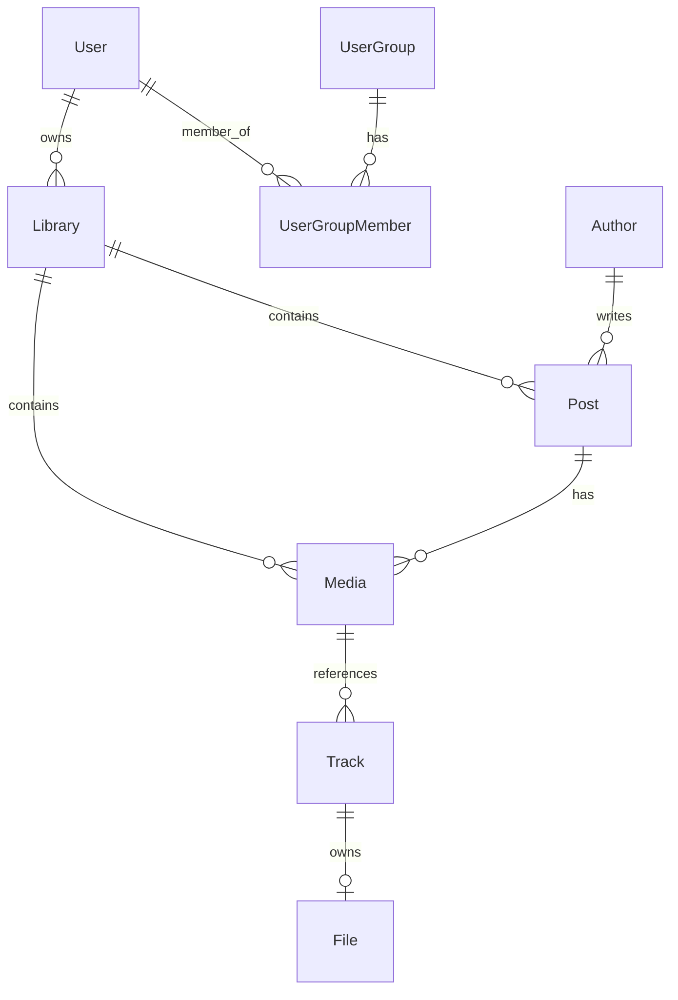
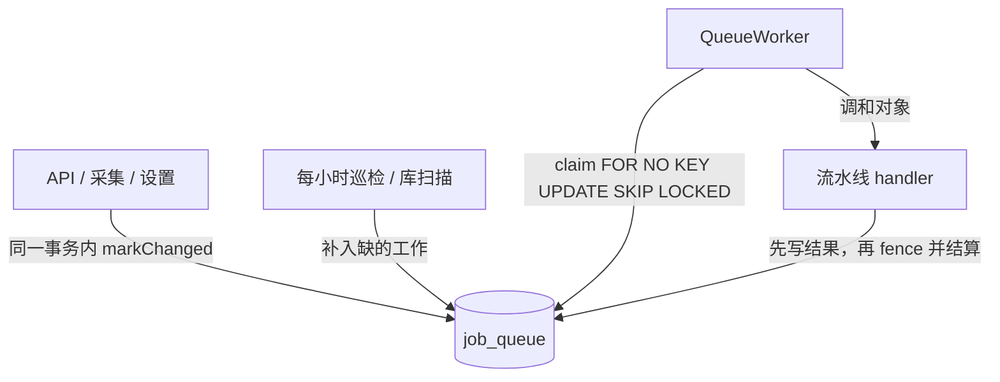

# 系统设计与数据库规范 (简体中文)

> [English](./system_design.md)

本篇文档主要阐述 Stationary 平台的业务模块关系、核心数据库设计原则、双轨制展示机制以及多租户权限隔离方案。

---

## 1. 数据库设计原则

为保证系统在高并发、海量资产导入与同步时的吞吐能力与横向扩展能力，项目在数据库层面遵循以下核心设计规范：

### 1.1 命名规范 (Snake Case)
- 数据库的所有表名、字段名必须**严格使用 `snake_case` (下划线命名法)**。例如：`avatar_file_id`, `create_time`, `sort_order`。
- 注：Better Auth 生成的底层系统表（如 `better_user`, `better_session`）由于依赖库底层映射，保留其默认命名格式，但业务拓展字段及所有新业务表必须遵守 `snake_case`。

### 1.2 无物理外键设计 (No Explicit Foreign Keys)
- **硬性要求**：在 Drizzle ORM 定义中，绝对不允许在列上声明物理外键 `.references()`（除注释说明外）。
- **设计 Rationale**：物理外键在分布式或大规模水平扩容时会造成严重的锁竞争与级联操作负担。
- **关联处理**：所有实体关联关系均为**逻辑关联**。关联的维护和业务完整性由应用层逻辑负责，并通过 Drizzle 的 `relations`（在 `relations.ts` 中通过 `defineRelations`）进行声明，以便在 API 层进行便捷的类型推导与 `with` 关联查询。

---

## 2. 核心数据模型关系

Stationary 的底层数据模型主要分为**内容层**、**资产层**、**用户与隔离层**。

### 2.1 内容层关系
- **Author (作者)**：跨平台唯一（通过 `library_id` + `platform` + `eid` 联合唯一）。保存多平台博主的昵称、签名、平台及头像文件引用（`avatar_file_id`）。
- **Post (帖子/文章)**：属于某一个 `Library`（媒体库）。是内容的逻辑载体，记录源站的 `eid`、标题、描述、标签及原始发布时间 (`published_time`)。
- **Media**：属于某个 `Post`，或作为独立媒体（`post_id` 为 null）。包含稳定外部身份 `eid`、排序、标题、描述、媒体类型（IMAGE、VIDEO、LIVE_PHOTO、AUDIO、PDF）和发布时间。Media 不再保存物理文件 URL，物理资源统一通过 `Track` 与 `File` 获取。

### 2.2 资产与物理存储层 (Track & File)
- **File（物理资产表）**：对应 S3 中的真实文件。以 UUID 唯一标识，记录可选的审计 hash、大小 `size`、全局唯一的 S3 对象路径 `path` 和存储桶 `bucket`。当前业务不支持在多个实体之间复用同一个 File；每个 Track、作者头像、媒体库封面和 Draft 上传都使用独立 File。文件尺寸、时长和播放格式属于 Track，而不是 File。
- **Track (媒体轨道表)**：作为 `Media` 与 `File` 之间的桥梁，表明一个物理文件在当前媒体中扮演的角色和格式。单个逻辑 `Media` 可以包含多个 `Track` 变体：
  - `type` (TrackType 轨道类型)：`IMAGE` (图片)、`VIDEO` (视频)、`AUDIO` (音频)、`SUBTITLE` (字幕)。
  - `purpose` (TrackPurpose 轨道用途)：
    - `CONTENT`：主轨道（如主视频轨、音频轨或原图）。
    - `COVER`：封面图（如视频对应的封面图）。
    - `THUMBNAIL`：提取的较小网格缩略图。
    - `PREVIEW`：低码率的预览流。
  - `quality` (TrackQuality 轨道画质)：`HIGH`, `MEDIUM`, `LOW`；原始性由 `is_original` 表达。
  - `priority` (优先级) 与 `source_url` (原始同步 URL)：后台同步下载时用于确定变体解析和流媒体选择的策略。
- **File 与删除规则**：File 由当前业务记录独占。业务记录被软删除或替换时，在同一事务中将对应 File 标记为 `DELETED`；S3 物理对象由后续 purge 任务清理。

---

## 3. 生命周期与删除策略 (Lifecycle & Deletion Policies)

在无物理外键的数据库架构下，应用层必须显式维护引用完整性并规范删除流程。

### 3.1 回收站语义 (软删除与硬删除)
为提供数据可恢复性并保证物理资产的一致性，删除流程分为两阶段：
- **进入回收站（软删除）**：`Post` 或 `Media` 的首次删除操作被定义为“软删除”。在表中将 `delete_status` 设置为 `DeleteStatus.DELETED`，并标记删除时间。对应的 Track 和其所属 File 会在同一事务中进入删除状态，S3 对象仍由后续 purge 任务处理。
- **清空回收站 (异步硬删除/Purge via Cron)**：
  1. 服务进程内置定时任务（`startFilePurgeSchedule`），在启动时及之后每 24 小时运行一次，所有部署方式都一致。多副本时每个副本都会运行，重复删除没有副作用。也可以携带 `Authorization: Bearer <CRON_SECRET>` 调用 `POST /api/task/purge-expired-files` 手动触发同一清理。
  2. 该任务检索已被标记为 `DELETED` 且超过 30 天的 `File` 记录。
  3. 针对每个已过期的 `File`，先删除 S3 物理对象，再删除对应的数据库记录。失败的文件会记录日志并在下次运行时重试。File 不会被其他业务记录复用。
  4. 这种软删除状态机确保 S3 物理资源与所属业务记录保持一致。

### 3.2 资源库删除策略
为了防止意外删除，非空的媒体库（Library）不支持直接删除。
- **删除前置检查**：在尝试删除某个资源库 `Library` 之前，系统必须检查该库下是否存在任何 `Post` 或 `Media`，包括回收站中的记录。
- **判定规则**：只要库下仍存留任何内容，系统将拒绝删除请求并提示用户先清空资源库及其回收站。只有在内容完全清空后，才允许删除 `Library` 记录本身。

---

## 4. 双轨制展示机制 (Dual-View System)

在交互层面，平台提供以下两套主要视图：

### 4.1 看板视图 (Board View / Post List)
- 展示是以 `Post` 为主体的流。每个 Card 对应一篇帖子，卡片封面上展示该帖子下 `sort_order` 为 0 的 `Media` 缩略图。
- 能够显示作者信息、帖子标题、发布时间与帖子包含的媒体总数。

### 4.2 资产视图 (All Pins / Media List)
资产视图允许用户越过 Post 维度，直接在图片/视频层面进行铺展。在此视图下支持**两种布局切换**：

| 布局模式 | 业务筛选逻辑 (SQL Filter) | 展现效果 |
| :--- | :--- | :--- |
| **平铺模式 (Flat)** | 无特殊限制，查询并排列所有 `Media` 记录 | 每一个独立的图片或视频都作为一个单独的 Card 渲染，用户可以高频检索细节资产。 |
| **堆叠模式 (Stacked)** | `or(isNull(Media.post_id), eq(Media.sort_order, 0))` | 将属于同一帖子的多张媒体卡片“折叠”起来。只显示无 Post 的独立媒体，以及每个帖子中的**首个媒体（`sort_order` 为 0）**。卡片上会显示角标（如 `+5`）提示该合辑下还有其他多张图片。 |

---

## 5. 多租户隔离与共享机制 (User Group & Library)

为支持多用户团队协作，系统引入了多级权限控制。所有权（谁持有并承担 AI 供应商等资源的费用）与访问权相互独立，详见 [ownership_and_teams.zh-Hans.md](ownership_and_teams.zh-Hans.md)，其中包括团队的规划方案。

### 5.1 访问资源实体
- **Library (媒体库)**：资产的物理隔离单位。每一个 Post 和 Media（如果关联）在创建时都必须指定所属的 `library_id`。

### 5.2 协作与权限
- 用户拥有独立的 `Library` 实例，亦可建立 `UserGroup` (用户组)。
- 系统支持两个维度的分享授权：
  1. **用户级别分享 (`LibraryUserAccess`)**：将 Library 的查看/编辑权限赋予特定 `User`。
  2. **用户组级别分享 (`LibraryGroupAccess`)**：将 Library 授权给整个 `UserGroup`（组内成员拥有 `LibraryGroupAccess` 定义的相应权限）。
- **权限角色 (AccessRole)**：
  - `VIEWER`：只读权限，可以浏览、搜索和检索资产。
  - `EDITOR`：编辑权限，可以创建/更新 Post、Media 并进行资产移动归档。
  - `ADMIN`：管理权限，除编辑外还可以执行媒体库删除、授权分享管理等高风险操作。

---

## 6. 后台任务队列 (Background Job Queue)

下载、封面、头像、AI 描述、搜索文档和向量这些后台工作，都跑在 PostgreSQL 里的调和队列（`job_queue`）和进程内的 `QueueWorker` 上。不依赖消息中间件；Redis 只用来在进程之间共享 AI provider 的限流。代码在 `apps/server/src/infra/queue`，完整设计见 [async_task_improvements.zh-Hans.md](./async_task_improvements.zh-Hans.md) 第 11 节。

### 6.1 数据模型

- **每个（队列, 对象）一行**：队列是一条流水线（`download`、`avatar`、`cover`、`ai.describe`、`ai.index`、`ai.text`、`ai.image`），向量流水线按空间分队列；每个库还有 `scan:` 队列。重复入队会合并到已有的行；行正在运行时只标记 `dirty`，这次运行结束后再跑一次。
- **流水线做调和，不重放命令**：handler 读对象的当前状态，把产出补到最新。写入方只报告对象的哪个方面变了（`markChanged`），`infra/queue/pipelines.ts` 负责把方面映射到读它的流水线。
- **结果记在结果行上**：失败和失败时的输入哈希写在产出旁边（如 `track.last_error`、`asset_embedding.last_error` 和 `error_input_hash`）。运行结束后队列行就删除。

### 6.2 执行与安全

1. **认领**：按优先级（变化先于回填）认领到期的行，用 `FOR NO KEY UPDATE SKIP LOCKED` 加租约，跳过用户暂停的库。worker 每秒轮询一次；过期租约由认领本身回收，没有单独的 sweeper。
2. **租约与 fencing**：租约 60 秒，每 20 秒续一次。先写结果，再 fence 队列行，丢了租约的 worker 提交不了。所有写入方都先锁结果行、后锁队列行。
3. **重试**：失败后带抖动指数退避（5 秒 × 4ⁿ，最多 300 秒），默认最多 5 次，之后把失败记到结果行上。被限流的运行只推迟，不计次数。provider 拒绝的输入在变化之前不再重试。
4. **至少一次**：崩溃后同一次运行可能重复，所以 handler 必须幂等。
5. **巡检与扫描**：启动时和之后每小时，给每个库的每条流水线入队一次 scan，按页扫描媒体，把缺的或过期的补进队列。

### 6.3 封面生成与调和行为规范 (Cover Generation & Reconciliation Specification)

媒体封面的生成、更新与调和逻辑由 `cover` 流水线与 `CoverService` 共同维护，遵循以下行为规范：

1. **手动重新生成与同规格覆盖**：
   - 当对已有封面的媒体手动触发生成某规格（如 `LOW` + `MEDIUM`）时，系统会重新提取渲染源媒体帧，将渲染出的 AVIF 文件上传至 S3 **覆盖原有 S3 路径**。
   - 数据库中的 `File` 记录（大小、尺寸、更新时间）与 `Track` 记录（`file_id`、`update_time`、`sync_status = COMPLETED`）会被同步更新。
2. **多规格独立并存**：
   - 若媒体已存在 `LOW` + `MEDIUM` + `HIGH` 三种规格，而任务仅派发了 `LOW` + `MEDIUM`，系统仅渲染并更新 `LOW` 与 `MEDIUM` 规格。
   - 已存在的 `HIGH` 规格 `Track` 记录与 S3 文件完全保留（保持 `ACTIVE` 状态），不会受到影响。
3. **`cover` 流水线规则**：
   - **增量调和 (Incremental Reconcile)**：流水线只负责补齐当前媒体库配置（`library.cover_qualities`）所要求的规格。
   - **配置缩减不裁切**：若媒体库配置由 `[LOW, MEDIUM, HIGH]` 缩减为 `[LOW, MEDIUM]`，`cover` 流水线**绝不清理或删除**已有的 `HIGH` 封面。
   - **配置恢复免重复计算**：若后续重新将配置改回 `[LOW, MEDIUM, HIGH]`，库扫描会找到已有的 `HIGH` 封面；只要它仍是由未变的源文件生成的，就算作最新，不会重新渲染。

